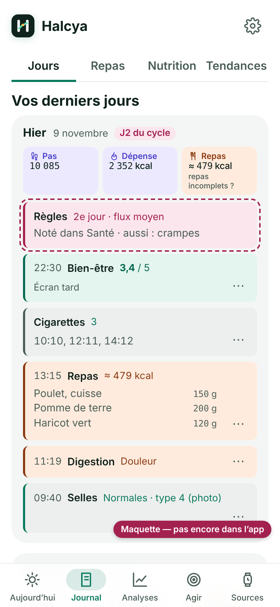
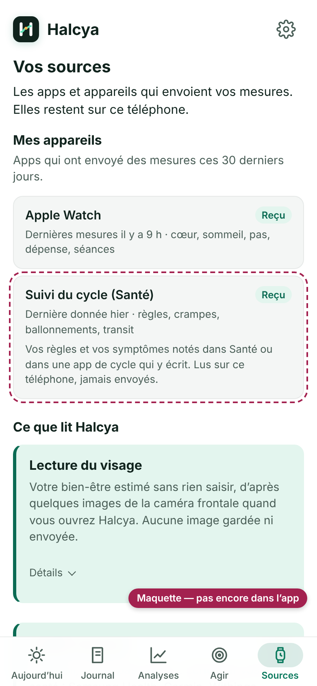

# Proposition : lire le cycle depuis l'app Santé sur iPhone

> Mode polish (décision du propriétaire du 07/11 au soir) : une idée de fonction est une proposition avec maquette,
> jamais codée sans son accord. Écrite le 10/11 à 15:15 (heure de Paris), après le passage des personas du jour.

## Le constat

Passage des personas du 10/11 (`journal/simulations/2026-11-10-1300-endometriose-iphone-J14.md`) : une femme atteinte
d'endométriose, iPhone seul, 14e jour, a coché « Mon cycle » à l'accueil, mais ne trouve aucun endroit pour son cycle.
Le même jour, Android a fait le même constat (`journal/BACKLOG.md` de HealthTrack, PROP-SIM-10 : « Mon cycle » ne
débloque rien de visible ; noter ses règles et relier cycle et douleurs).

## L'idée propre à l'iPhone

Sur iPhone, beaucoup de femmes notent déjà leurs règles dans l'app Santé (Suivi du cycle) ou dans une app de cycle qui y
écrit (Clue, Flo…). Santé garde aussi les symptômes notés avec : crampes, ballonnements, constipation, diarrhée. Halcya
pourrait les lire, comme il lit déjà le sommeil, le cœur et les pas, sans rien demander de plus à l'utilisatrice que
l'autorisation de Santé.

- **Journal › Jours** (maquette 1) : une ligne « Règles · 2e jour · flux moyen », « Noté dans Santé », et le jour du
  cycle à côté de la date.
- **Sources** (maquette 2) : « Suivi du cycle (Santé) » dans « Mes appareils », avec ce qui a été reçu et la phrase de
  confidentialité (lu sur le téléphone, jamais envoyé).
- **Analyses**, plus tard : le cycle comme variable de contrôle de la digestion (même règle qu'Android pour Health
  Connect, I34 de son BACKLOG), jamais comme cause ; une piste, pas un diagnostic.

 

Les maquettes sont l'app iPhone (variante App Store, données de démo du 14e jour) avec les éléments ajoutés à la main,
entourés en pointillés.

## Ce que ça demanderait

- **Code partagé (Android)** : une façon de ranger et de montrer le cycle (type d'entrée, ligne du Journal, jour du
  cycle). C'est la même brique que PROP-SIM-10 (saisie des règles) et I34 (règles lues dans Health Connect) côté
  Android : à décider ensemble, pour que l'export et l'import JSON passent d'un téléphone à l'autre.
- **iPhone** : un petit lecteur natif (Swift) des types de Santé « règles » (`menstrualFlow`) et des quatre symptômes
  digestifs (`abdominalCramps`, `bloating`, `constipation`, `diarrhea`, documentation d'Apple « Symptom type
  identifiers », lue le 10/11) ; le module Santé utilisé aujourd'hui (`@capgo/capacitor-health` 8.4.5) ne les lit pas.
  Une ligne de plus dans la demande d'autorisation de Santé ; rien ne sort du téléphone.
- **Confidentialité** : « Santé » est déjà déclaré dans la Confidentialité de l'app (05/11) ; la phrase d'accès à Santé
  et `confidentialite.md` seraient complétées.

## La réponse attendue

« ok cycle Santé » (je le prépare avec Android, qui mène le code partagé), « plus tard », ou « non ».
