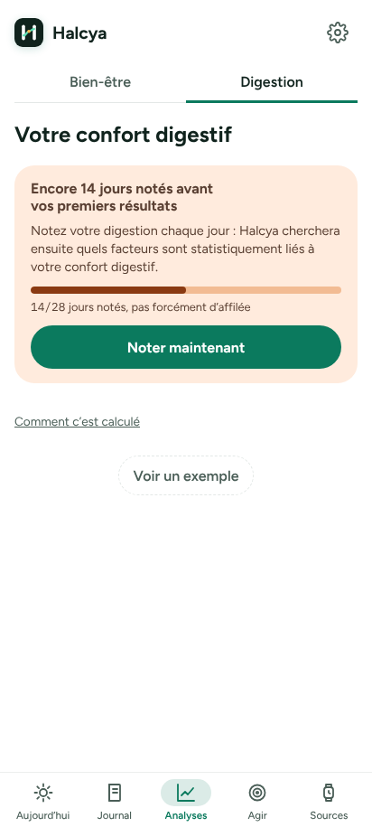

# Proposition PROP-SIM-17 — un bilan digestif simple avant le 28e jour

> **Proposition au propriétaire, rien n'est codé.** Mode polish (décision A du 07/11) : une idée de fonction
> attend son accord. Maquette statique sur données synthétiques : `maquette.html` (`?state=j14|j5`, `?theme=dark`),
> captures par `node journal/maquettes/bilan-digestif/render.mjs`. Run « idées » du 14/11 20:35.

| Aujourd'hui (14e jour) | Proposé, 14e jour | Proposé, sombre | Proposé, 5e jour, aucune douleur |
|---|---|---|---|
|  |  |  |  |

## Le problème
Analyses › Digestion ne montre qu'un compte à rebours pendant 28 jours notés. Les personas « ventre » y viennent
chercher « quoi éviter » et repartent sans rien : constat des simulations du 12/11 (Ventre et données J45), du
13/11 (Ventre, sans technique J45) et du 14/11 (Ventre, sans technique J14 : « deux semaines que je note et l'écran
me dit d'attendre »). C'est la cible d'entrée du produit, au moment où elle décide si elle continue à noter.

## Ce que la maquette propose
Sous le compte à rebours, raccourci à une ligne, un relevé de ce que la personne a déjà noté :
1. **Ses jours notés**, une case par jour : calme, avec une gêne, avec une douleur (trois tons d'orange, la couleur
   de la digestion), un jour sans note en pointillés ; le compte de chaque sorte dessous.
2. **Ses jours de douleur**, un par carte : l'heure de la douleur et les repas notés dans les 24 heures d'avant,
   dans l'ordre, avec leur heure ; un lien ouvre ce jour dans le Journal. Sans douleur notée : « Aucune douleur
   notée pour l'instant. »
3. Une phrase dit ce que c'est : « Un relevé de vos notes. Pour dire ce qui joue sur votre ventre, Halcya attend
   28 jours notés. »

## Ce que ce n'est pas (et pourquoi)
- **Aucun suspect, aucun classement d'aliments, aucun chiffre de lien.** Deux jours de douleur ne permettent rien
  de tel ; c'est le reproche fait à mySymptoms (étude du 20/10) et l'honnêteté statistique est notre angle. Le
  relevé montre des repas, il ne les compare pas.
- Rien de nouveau n'est demandé à la personne et aucune donnée nouvelle n'est enregistrée : tout vient des repas et
  des notes de digestion déjà dans le téléphone. Rien ne sort du téléphone.
- Gratuit, comme le Journal (« collecter est gratuit ») ; les analyses avec délais restent ce qui se paie.
- Le bloc disparaît quand les premiers résultats arrivent (28 jours notés) : une information n'a qu'une maison.

## Risque à peser
Montrer les repas d'avant une douleur invite la personne à conclure seule (« c'est la pizza »). La maquette limite
ce risque (repas dans l'ordre, sans mise en avant, phrase finale), sans l'annuler. Variante plus prudente si vous
préférez : garder seulement le point 1 (les jours et leur compte) et le lien vers le Journal.

## Si vous dites oui
Trois étapes testables : (a) le calcul du relevé, testé (fenêtre de 24 heures, jours sans note, plusieurs douleurs
le même jour) ; (b) l'écran sur Android, captures claires et sombres, données vierges et de démo ; (c) le suivi
iPhone (code partagé, ligne dans `PARITE.md`). Réponse attendue : « PROP-SIM-17 oui », « oui, variante prudente »
ou « non ».
