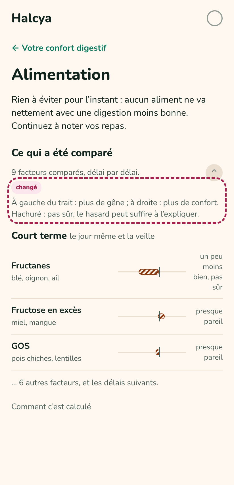
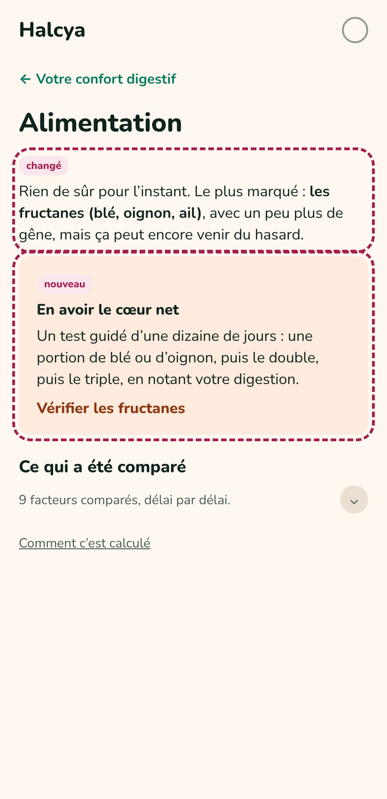
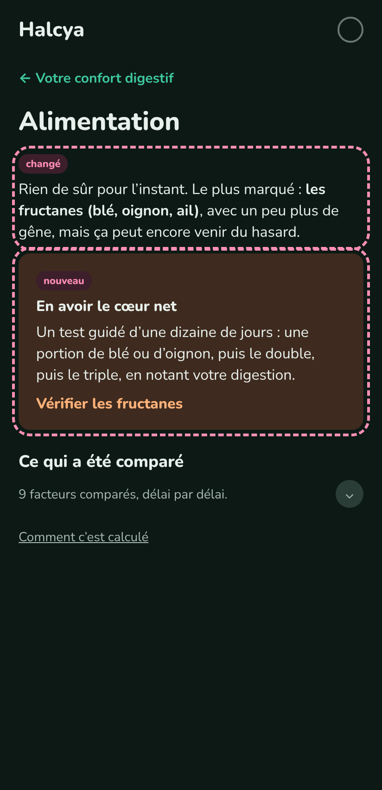
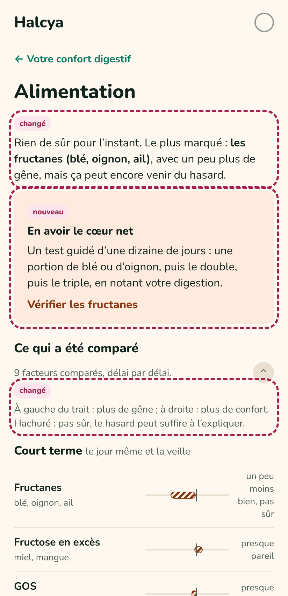

# Proposition PROP-SIM-20 — « Rien à éviter », puis « Fructanes −1,2 pt » juste dessous

> **Proposition au propriétaire, rien n'est codé.** Mode polish (décision A du 07/11) : un changement du verdict
> d'une analyse et un nouveau lien attendent son accord. Maquette statique sur données synthétiques : `maquette.html`
> (`?state=avant|avant-ouvert|a|a-ouvert|b`, `?theme=dark`), captures par `node journal/maquettes/rien-a-eviter/render.mjs`.
> Run du 27/11 01:30. Les pointillés roses marquent ce qui change.

| 0. Aujourd'hui (détail ouvert) | 1. Option A | 1. Sombre | 2. Option A, détail ouvert | 3. Option B |
|---|---|---|---|---|
|  |  |  |  |  |

## Le problème
- Objectifs › Confort digestif › Alimentation, sans piste nette : « Rien à éviter pour l'instant : aucun aliment ne
  va nettement avec une digestion moins bonne » (`FAMILY_NONE`, `pages/Recommendations.jsx`). Sous le chevron :
  « Fructanes −1,2 pt » avec une grosse barre hachurée, « Fructose en excès +0,5 » le jour même, « −1,3 » ensuite.
- La persona « Ventre, sans technique » le relève pour la **3ᵉ fois** (20/11, 25/11, 26/11 20:30, J45) : « Alors je
  dois éviter l'oignon ou pas ? C'est bon ou c'est mauvais ? » Sa tâche « savoir quoi éviter » échoue.
- « Rien à éviter » affirme une absence que les données ne prouvent pas ; le tableau parle en « pt », « GOS »,
  « FODMAP » (reste de POLISH-SIM-173).

## Option A (recommandée) : dire le plus marqué, sans conclure, et proposer de vérifier
1. Le verdict devient « **Rien de sûr pour l'instant.** Le plus marqué : les fructanes (blé, oignon, ail), avec un
   peu plus de gêne, mais ça peut encore venir du hasard. » Seulement si le facteur le plus marqué va vers « moins
   bien » et dépasse un seuil d'écart (par exemple 0,5 point) ; sinon la phrase de l'option B.
2. Sous le verdict, une carte « **En avoir le cœur net** » vers la réintroduction guidée de ce groupe (elle existe,
   `pages/Reintroduction.jsx`, groupe présélectionné comme depuis une piste) ; hors groupe FODMAP, « Vérifier par
   un essai » (Objectifs › essai). Dans la variante play sans abonnement, le lien mène au paywall comme les pistes.
3. Sous le chevron, les chiffres « −1,2 pt » deviennent des mots (« un peu moins bien, pas sûr », « presque
   pareil »), les sous-titres « pour 1 repas riche en … (FODMAP : …) de plus » deviennent les aliments seuls, et une
   légende dit le sens de la barre et du hachuré. Le chiffre exact reste dans « Comment c'est calculé ».

Pourquoi c'est honnête : rien n'est appelé « à éviter » ni « cause » ; c'est le principe A1 (« la valeur finale est
une réponse vérifiée par un essai, pas une corrélation ») appliqué au cas le plus fréquent, où rien n'est net.
Règles 5 et 6 inchangées : aucune norme, rien de jugé par principe, l'incertitude dite en mots simples.

Risque : nommer un suspect pas encore net, c'est ce que les testeurs reprochent à mySymptoms (« faux suspects »).
La parade est dans la phrase (« ça peut venir du hasard ») et dans le lien vers le test, qui tranche.

## Option B : seulement corriger le verdict
« Rien de sûr pour l'instant : aucun aliment ne va nettement avec une digestion moins bonne. Les écarts du détail
peuvent venir du hasard. Continuez à noter vos repas. » Ne nomme rien et n'ajoute rien ; lève la contradiction
apparente, pas la question « que faire ? ».

## Si vous dites oui
Un run de code, iPhone dans le même run (code partagé, un build iPhone) : tests d'abord (`Recommendations.test.jsx` :
verdict avec et sans facteur marqué, seuil, lien vers la réintroduction du bon groupe, variante sans abonnement ;
`SLOP_WORDING` sur les nouveaux textes), captures `--history-days=45` claires et sombres.

Réponse attendue : **« PROP-SIM-20 A »**, **« PROP-SIM-20 B »** ou **« non »**.
